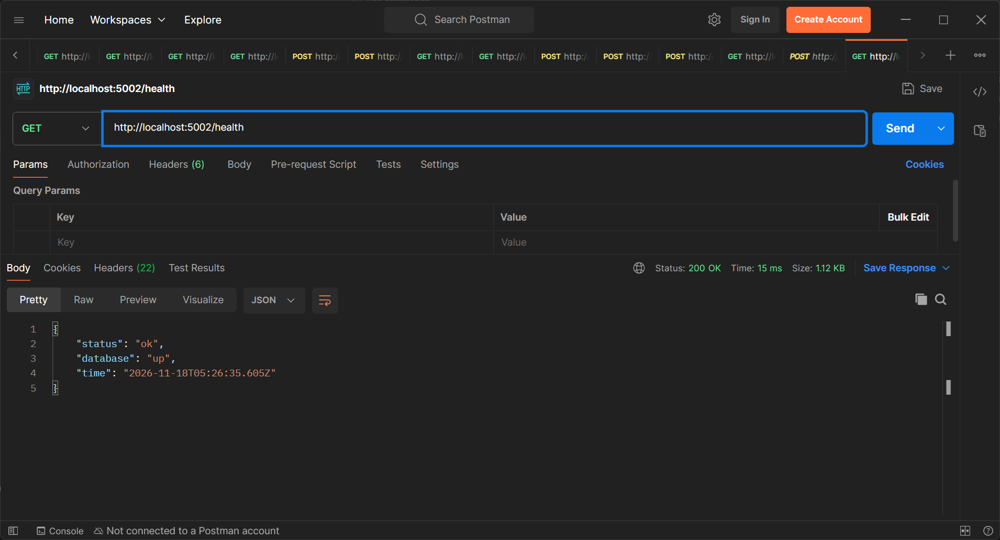
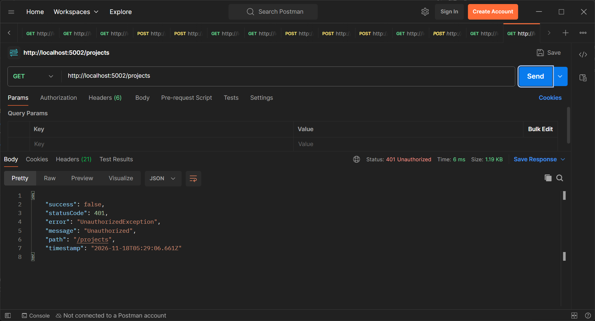
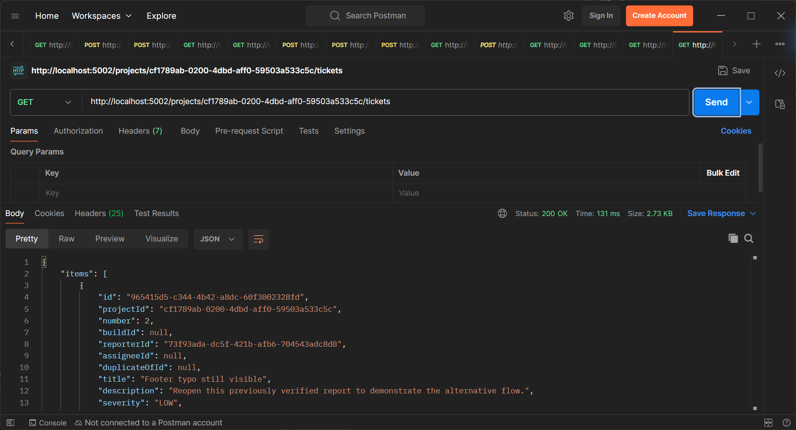
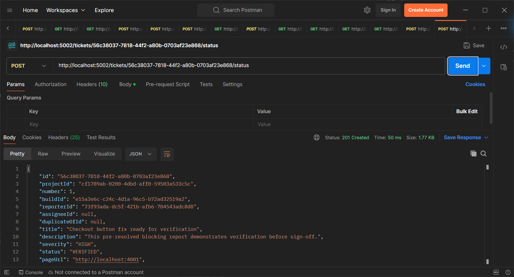
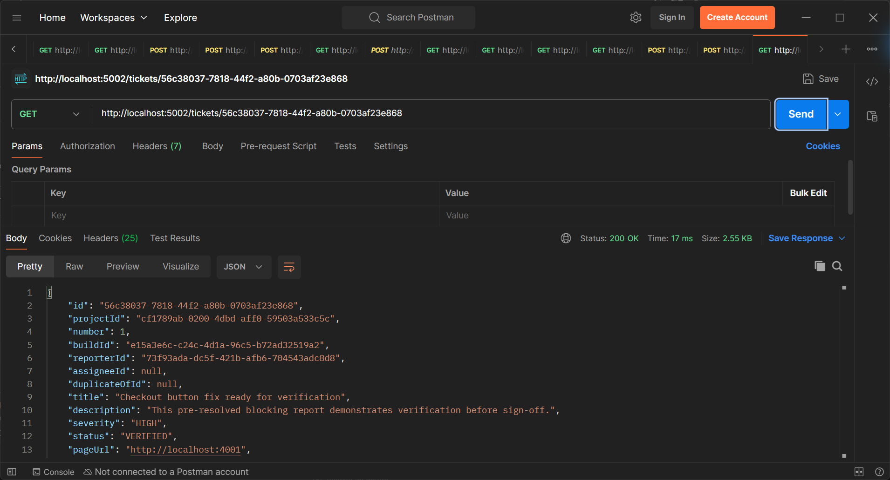
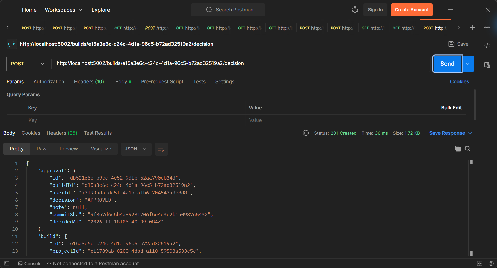
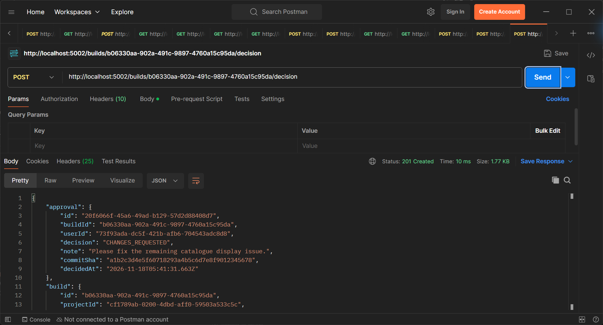

# InspectFlow — Tester / Client Reviewer

Tester features include reporting issues, viewing reports, verifying or reopening fixes, and reviewing builds. This branch also includes the website UI.

## Local setup

Use Node.js 22, pnpm 12.16.1, and PostgreSQL. Run these commands from the repository root on the `test` branch.

```powershell
pnpm install --frozen-lockfile
# Requires Docker Desktop to be installed and running
docker compose up -d postgres
if (-not (Test-Path 'apps/api/.env')) {
  Copy-Item 'apps/api/.env.example' 'apps/api/.env'
}
pnpm setup:db
pnpm dev:api
```

Before `pnpm setup:db`, check `apps/api/.env`. The included Docker database uses port **5434**, database/user `inspectflow_actor`, and local demo password `inspectflow_actor_demo`. Set local JWT secrets and keep `.env` out of Git. If using installed PostgreSQL instead of Docker, create a separate `inspectflow_actor` database and set its actual connection details in `DATABASE_URL`.

We use a separate local database to test Tester actions without changing the full project's shared database. The existing schema/migrations are used; only the database connection changes.

Keep the API terminal and PostgreSQL running. First send **GET http://localhost:5002/health** and confirm `database: up`. `localhost` means the laptop running Postman. If necessary, replace it with `127.0.0.1`. A cloned repository does not automatically start a server.

## Postman preparation

1. Send **POST http://localhost:5002/auth/login** with **Body → raw → JSON**

   ```json
   {"email":"tester@inspectflow.demo","password":"Demo@12345"}
   ```

2. Copy `accessToken` into **Authorization → Bearer Token** for checks 3–10. Checks 1–2 use **No Auth**. Log in again when the token expires.
3. Get your local IDs using authenticated requests
   - `GET http://localhost:5002/projects` — find Acme Shop Reviewer Demo.
   - `GET http://localhost:5002/projects/{projectId}/tickets` — find tickets with `number: 1` and `number: 2`.
   - `GET http://localhost:5002/projects/{projectId}/builds` — find Checkout build and Catalogue build.
4. Replace the example project/ticket/build IDs below with your returned IDs. Choose the method separately from the URL. POST bodies use **raw → JSON**.
5. Follow checks 1–10 in order on fresh demo data. IF-1 starts `RESOLVED`, IF-2 `VERIFIED`, and both builds `IN_REVIEW`. Re-seeding preserves existing changes; it does not reset a completed rehearsal.

## Ten Postman checks

These full-window PNGs were captured in Postman Desktop during a fresh local test against a separate PostgreSQL demo database. Each caption gives the exact request URL shown. On another database, substitute its IDs as described above. Click an image to view its original size.

### 1. API and database health

Expected **200 OK**. The response has `status: "ok"` and `database: "up"`.

> **GET** `http://localhost:5002/health`



### 2. Authentication is required

Expected **401 Unauthorized**. This is an intentional rejection.

> **GET** `http://localhost:5002/projects`



### 3. List the Tester's reports

Expected **200 OK**. The `items` array contains the reports visible to the Tester.

> **GET** `http://localhost:5002/projects/cf1789ab-0200-4dbd-aff0-59503a533c5c/tickets`



### 4. Block approval before verification

Body `{"decision": "APPROVED"}`

Expected **409 Conflict**. With Checkout build still `IN_REVIEW`, IF-1 has High severity and is not verified.

> **POST** `http://localhost:5002/builds/e15a3e6c-c24c-4d1a-96c5-b72ad32519a2/decision`


### 5. Verify the resolved fix

Body `{"status": "VERIFIED"}`

Expected **201 Created**. IF-1 changes from `RESOLVED` to `VERIFIED`.

> **POST** `http://localhost:5002/tickets/56c38037-7818-44f2-a80b-0703af23e868/status`



### 6. Read the saved ticket again

Expected **200 OK**. A separate read returns `status: "VERIFIED"`, confirming the update is persisted..

> **GET** `http://localhost:5002/tickets/56c38037-7818-44f2-a80b-0703af23e868`



### 7. Review Checkout build

Expected **200 OK**. The response includes the build and `myRole: "TESTER_CLIENT"`.

> **GET** `http://localhost:5002/builds/e15a3e6c-c24c-4d1a-96c5-b72ad32519a2/review`


### 8. Approve the verified build

Body `{"decision": "APPROVED"}`

Expected **201 Created**. The response records `approval.decision: "APPROVED"` and `approval.commitSha`.

> **POST** `http://localhost:5002/builds/e15a3e6c-c24c-4d1a-96c5-b72ad32519a2/decision`



### 9. Reopen the separate verified report

Body `{"status": "OPEN", "note": "Issue still visible in the QA demo"}`

Expected **201 Created**. IF-2 changes from `VERIFIED` to `OPEN`.

> **POST** `http://localhost:5002/tickets/965415d5-c344-4b42-a8dc-60f3002328fd/status`


### 10. Request changes on Catalogue build

Body `{"decision": "CHANGES_REQUESTED", "note": "Please fix the remaining catalogue display issue."}`

Expected **201 Created**. The response records the `CHANGES_REQUESTED` decision, the note and the build commit SHA.

> **POST** `http://localhost:5002/builds/b06330aa-902a-491c-9897-4760a15c95da/decision`



## Quick troubleshooting

- **Connection refused / no response** — start PostgreSQL and `pnpm dev:api`; check API port 5002.
- **401** — use a fresh login token. Check 2 deliberately expects 401.
- **400 / 404** — check method, JSON and IDs from your own database.
- **409** — inspect the current ticket/build state. Check 4 deliberately expects a blocked approval.

Optional browser pages are Dashboard `http://localhost:3001/login`, Staging `http://localhost:4001/`, and Swagger `http://localhost:5002/api/docs`. Dashboard and Staging require their respective apps to be running.

## Code reference

- [API routes and business rules](apps/api/src/modules)
- [Database schema, migrations and demo seed](apps/api/prisma)
- [Dashboard UI](apps/web/src)
- [Staging HTML, CSS and JavaScript](apps/staging/src)
- [Screenshot reporting widget](apps/widget/src)

After integrating the team branches, deployment configuration for Vercel, Render and Supabase and separate deployed-API screenshots will be handled later.
