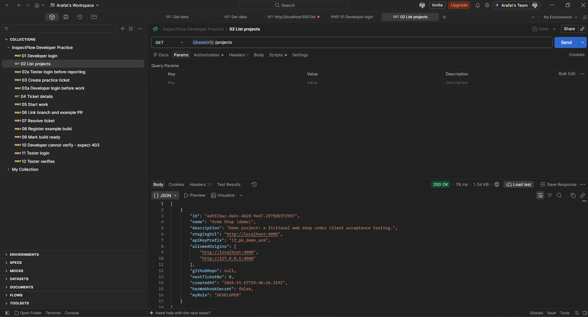
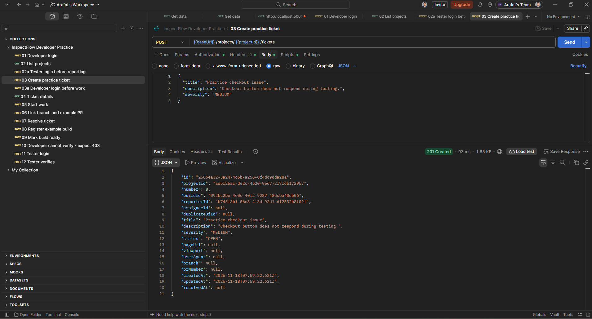
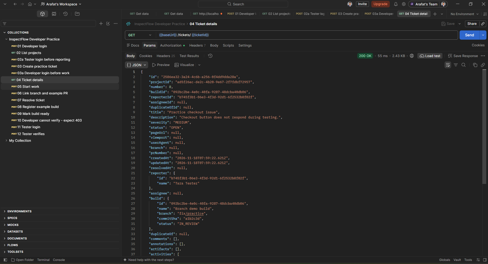
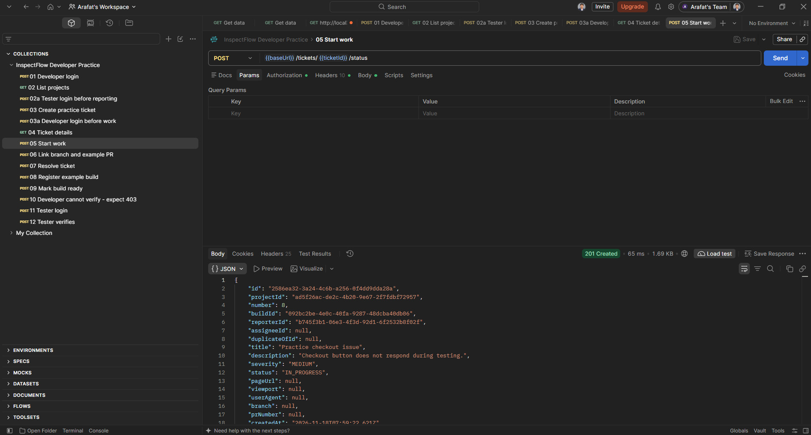
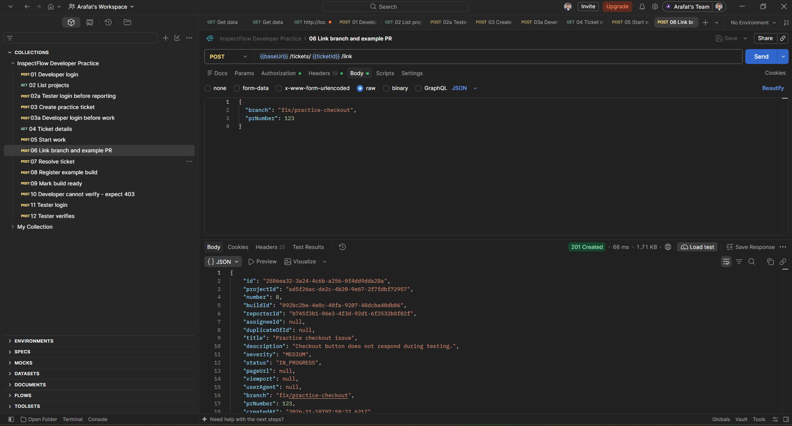
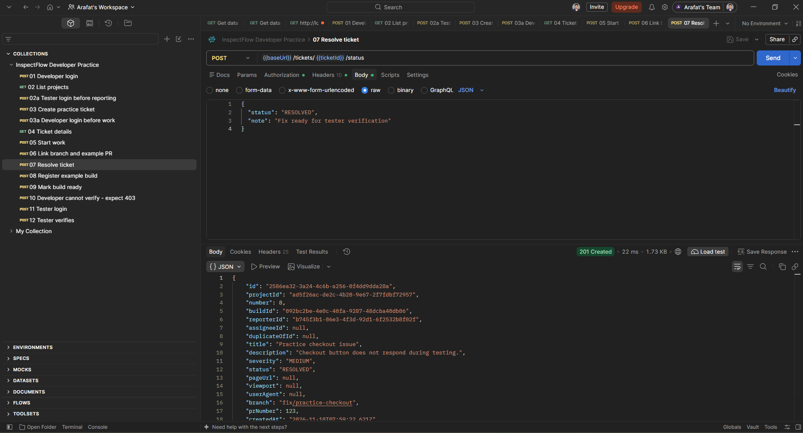
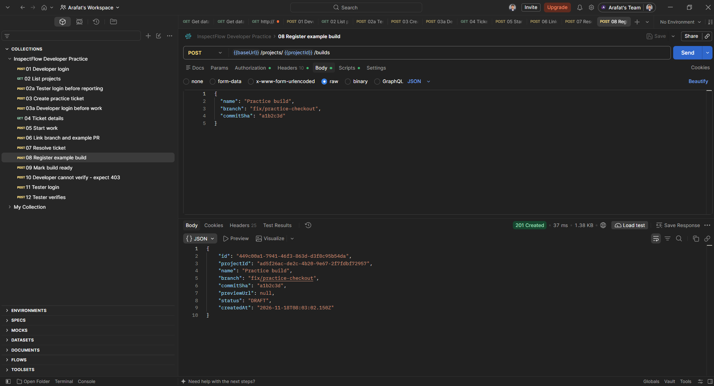
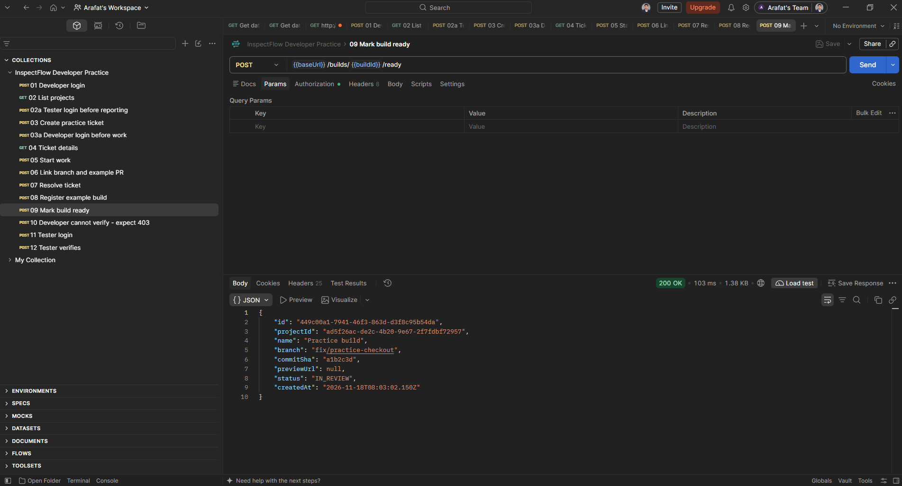
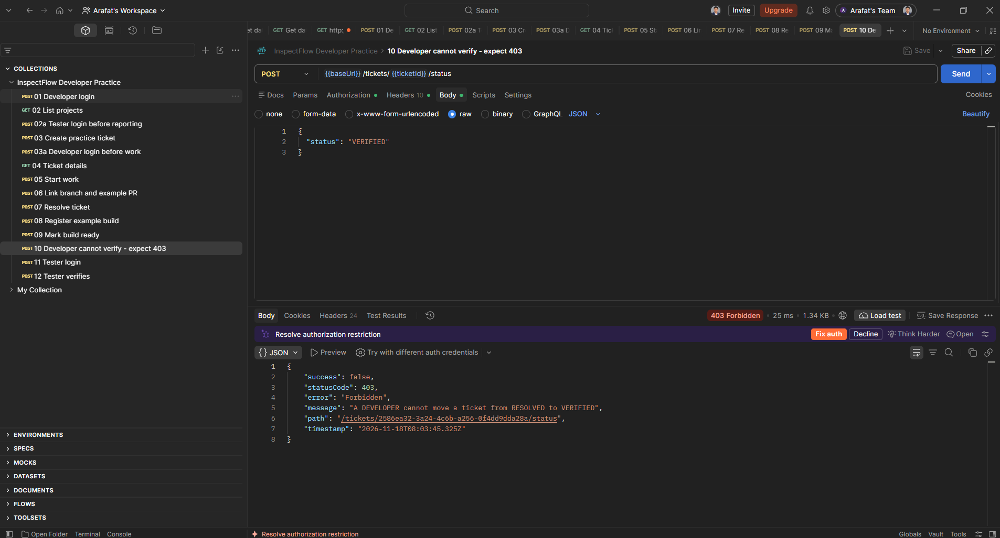
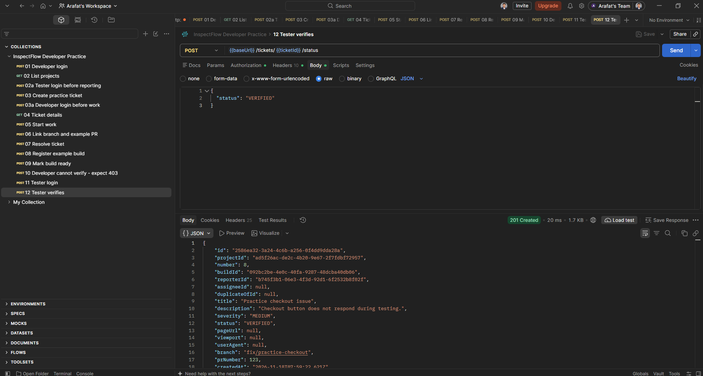

# InspectFlow Developer Actor

This folder documents the Developer actor's backend workflow, the code integrated on the `developer` branch, and a Postman practice run. InspectFlow tracks staging-site issues from a tester's report through a developer's fix and subsequent verification. Developers can also register a build and prepare it for review.

This documentation is maintained under `docs/developer/` on the Developer branch. The root README is not changed here. If this folder is included in a future merge, it will also appear in the target branch; select changes deliberately when merging.

## Scope and implementation

- Ticket lifecycle transitions for Developers and Leads, with Tester/Client or Lead verification.
- Ticket updates, assignment validation, branch and pull-request information linking, and duplicate marking.
- Build registration, draft editing, and marking a draft build ready for review.
- Project membership access corrections, with explicit role restrictions where needed.
- Workflow and membership-access unit tests, a Postman collection, and this guide.

The implementation was adapted from the supplied InspectFlow project archive and integrated into this branch. The access fix, tests, setup, integration and verification should be described according to the work actually performed. Commit history does not by itself establish original authorship of every line.

## Architecture and code map

`Postman → NestJS guard/controller → DTO validation → service → Prisma → PostgreSQL → JSON response`

| Area | File | Purpose |
| --- | --- | --- |
| Routes | [tickets.controller.ts](../../apps/api/src/modules/tickets/tickets.controller.ts) | Receives ticket requests and delegates to the service |
| Validation | [ticket.dto.ts](../../apps/api/src/modules/tickets/dto/ticket.dto.ts) | Defines ticket input fields and validation rules |
| Workflow | [ticket-workflow.ts](../../apps/api/src/modules/tickets/ticket-workflow.ts) | Defines permitted transitions by role |
| Business logic | [tickets.service.ts](../../apps/api/src/modules/tickets/tickets.service.ts) | Checks access, updates tickets and records activity |
| Builds | [builds.controller.ts](../../apps/api/src/modules/builds/builds.controller.ts), [builds.service.ts](../../apps/api/src/modules/builds/builds.service.ts) | Registers builds and prepares them for review |
| Access | [project-access.service.ts](../../apps/api/src/modules/access/project-access.service.ts) | Checks membership and explicit role restrictions |
| Tests | [ticket-workflow.spec.ts](../../apps/api/src/modules/tickets/ticket-workflow.spec.ts), [project-access.service.spec.ts](../../apps/api/src/modules/access/project-access.service.spec.ts) | Checks workflow and membership rules |

The status workflow demonstrated below is `OPEN → IN_PROGRESS → RESOLVED → VERIFIED`. Other role-specific transitions exist; the workflow file is the authority. A Developer cannot move a resolved ticket to `VERIFIED`. A Tester can verify their own report; a Lead may also verify according to the transition rules.

## Local setup

Use Node.js 22 or later, pnpm and PostgreSQL. Create a separate development database and configure `apps/api/.env` from `apps/api/.env.example` with its connection string and local secrets. From the repository root:

```powershell
pnpm install --frozen-lockfile
pnpm --filter @inspectflow/api prisma:generate
pnpm --filter @inspectflow/api migration:run
pnpm --filter @inspectflow/api seed
pnpm dev:api
```

The seed resets the demo project: use it only on a dedicated local practice database, never real or shared data. After initial setup, start PostgreSQL and run `pnpm dev:api`; reseeding is not necessary each time. The API port is configured by `PORT`. The supplied [Postman collection](Developer.postman_collection.json) defaults to `http://localhost:5001`; adjust its `baseUrl` collection variable to match the running server. Swagger is available at `/api/docs` on the running API.

Import the collection and send requests in order. It stores the token and IDs in collection variables. The practice accounts are fictional seeded users. The collection switches from Developer to Tester to create the ticket, back to Developer for the work, then back to Tester to verify it. A new run creates new demo records.

## Postman evidence

The following are supplied screenshots of a local practice run. They were captured from the local practice copy of the full project, not captured directly from this GitHub branch. Response fields and IDs can therefore differ from the current branch or from a later run. Separately, the branch was built and its developer login, project access, ticket operations, build registration and role handoff were exercised against a local demo database. No production or real GitHub integration is demonstrated here.

Four supplied login screenshots are omitted because they expose access and refresh tokens. Their `200 OK` responses were visible in the supplied screenshots; the steps are listed below without publishing tokens.

| Order | Request | Result visible in the practice screenshots |
| --- | --- | --- |
| 01 | `POST /auth/login` as Developer | 200; Developer login succeeded. Token-bearing image omitted. |
| 02 | `GET /projects` | 200; demo project returned with `myRole: DEVELOPER`. |
| 02a | `POST /auth/login` as Tester | 200; Tester login succeeded. Token-bearing image omitted. |
| 03 | `POST /projects/:projectId/tickets` | 201; Tester-created ticket starts as `OPEN`. |
| 03a | `POST /auth/login` as Developer | 200; Developer logged in for the work. Token-bearing image omitted. |
| 04 | `GET /tickets/:ticketId` | 200; ticket details show its reporter and `OPEN` status. |
| 05 | `POST /tickets/:ticketId/status` | 201; ticket is `IN_PROGRESS`. |
| 06 | `POST /tickets/:ticketId/link` | 201; example branch and PR number are stored. |
| 07 | `POST /tickets/:ticketId/status` | 201; ticket is `RESOLVED`. |
| 08 | `POST /projects/:projectId/builds` | 201; example build is `DRAFT`. |
| 09 | `POST /builds/:buildId/ready` | 200; build becomes `IN_REVIEW`. |
| 10 | `POST /tickets/:ticketId/status` as Developer | Expected 403; Developer cannot move `RESOLVED` to `VERIFIED`. |
| 11 | `POST /auth/login` as Tester | 200; Tester login succeeded. Token-bearing image omitted. |
| 12 | `POST /tickets/:ticketId/status` as Tester | 201; the Tester's own report becomes `VERIFIED`. |

The Postman branch name, PR number and commit SHA are example values stored in local records. They do not create a Git branch, pull request or commit, and do not test GitHub webhook delivery. The build registered in step 08 is a separate demonstration record; the screenshots do not establish that the earlier ticket is linked to that newly registered build.

### 02 Project list



### 03 Tester creates a ticket



### 04 Developer views the ticket



### 05 Developer starts work



### 06 Developer links Git information



### 07 Developer resolves the ticket



### 08 Developer registers a build



### 09 Developer prepares the build for review



### 10 Developer verification is denied



### 12 Tester verifies the fix



## Integration note

The remote `main` branch has advanced since this branch was created. Coordinate with teammates before merging, especially changes to shared ticket, access, project and build files. A separate branch does not guarantee a conflict-free merge. Review the current merge diff and test the combined result before submitting it.
