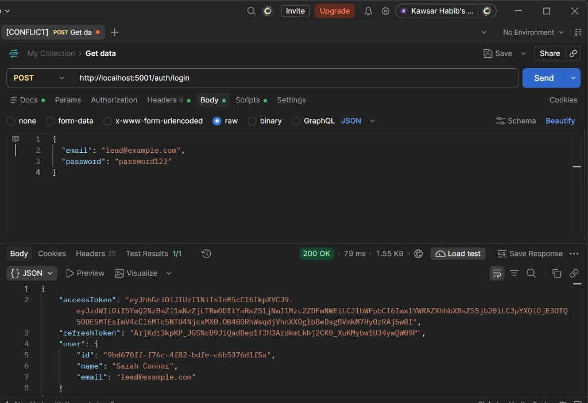
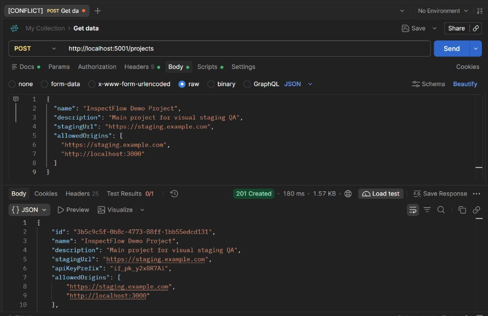
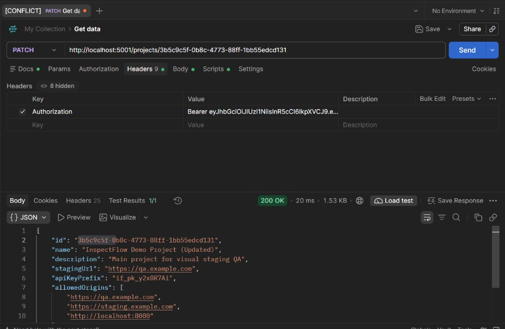
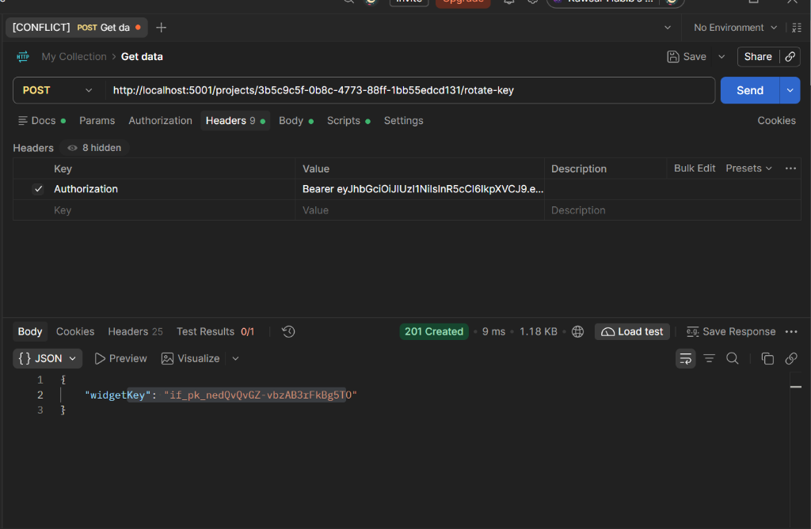
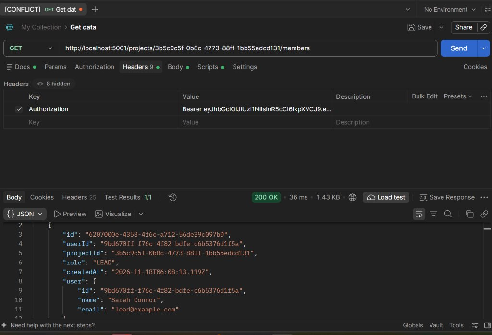
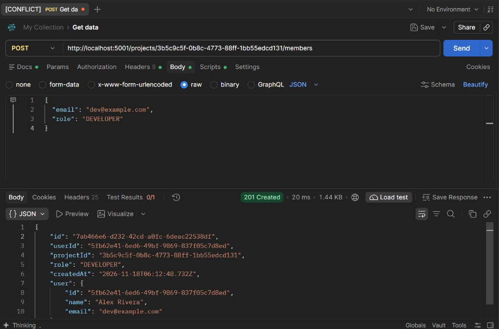
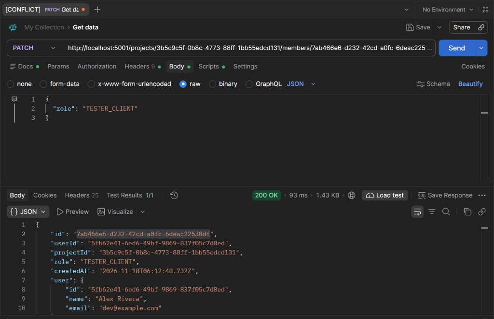
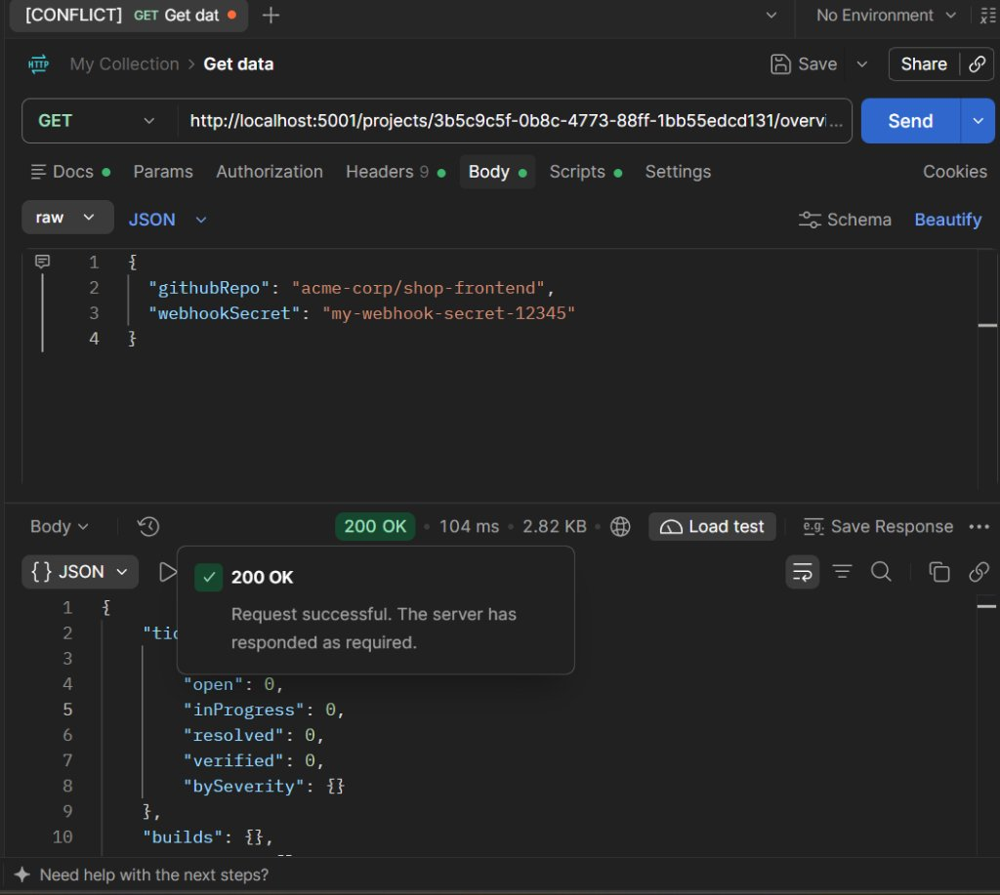

# InspectFlow — Project Lead (Actor 10.3) Documentation & API Output Proofs

**Contributor:** Kawsar Habib (`ProjectLead` branch)  
**Repository:** [Advance-Web-Tec-Mid-Project](https://github.com/Jisan179/Advance-Web-Tec-Mid-Project)  
**Assigned Role:** Project Lead (Actor 10.3)  
**Backend Port:** `5001` (NestJS) | **Database:** PostgreSQL  

---

## 1. Role Scope & Features Overview

The **Project Lead** is responsible for administrative project governance, security configurations, team delegation, and status tracking.

| Feature Area | Priority | Operations Covered | Endpoints |
|---|---|---|---|
| **Authentication** | Required | Login as Lead, acquire JWT Access Token | `POST /auth/login` |
| **Project Settings** | **Essential** | Create Project, Generate Widget Key, Update Allowed Domains, Edit Details | `POST /projects`<br>`PATCH /projects/:id`<br>`POST /projects/:id/rotate-key`<br>`DELETE /projects/:id` |
| **Member Management** | **Essential** | List Members, Invite/Add Members, Modify Roles (`LEAD`, `DEVELOPER`, `TESTER_CLIENT`), Remove Members | `GET /projects/:id/members`<br>`POST /projects/:id/members`<br>`PATCH /projects/:id/members/:mId`<br>`DELETE /projects/:id/members/:mId` |
| **GitHub Connection** | **Essential** | Link Repository (`owner/repo`), Webhook Secret generation | `PATCH /projects/:id/github`<br>`GET /projects/:id/webhook-deliveries` |
| **Overview Report** | Optional | Ticket breakdown by status/severity, build status, activity audit stream | `GET /projects/:id/overview` |

---

## 2. API Output Proofs & Screenshots

Each of the screenshots below validates the functionality implemented for the Project Lead role.

---

### Proof 1: Authentication — Login as Project Lead


* **HTTP Method:** `POST`
* **Endpoint:** `http://localhost:5001/auth/login`
* **Status Code:** `200 OK` (79 ms)
* **Request Payload:**
  ```json
  {
    "email": "lead@example.com",
    "password": "password123"
  }
  ```
* **Output / Verification:**
  * Returns high-entropy signed `accessToken` (JWT) and `refreshToken`.
  * Authenticates user `Sarah Connor` (`id: 9bd670ff...`) as the Project Lead.
  * The `accessToken` is injected into subsequent requests via the `Authorization: Bearer <token>` header.

---

### Proof 2: Project Creation & Widget Key Provisioning


* **HTTP Method:** `POST`
* **Endpoint:** `http://localhost:5001/projects`
* **Status Code:** `201 Created` (180 ms)
* **Request Payload:**
  ```json
  {
    "name": "InspectFlow Demo Project",
    "description": "Main project for visual staging QA",
    "stagingUrl": "https://staging.example.com",
    "allowedOrigins": [
      "https://staging.example.com",
      "http://localhost:3000"
    ]
  }
  ```
* **Output / Verification:**
  * Project `3b5c9c5f-0b8c-4773-88ff-1bb55edcd131` created in database.
  * Public `apiKeyPrefix` generated: `if_pk_y2x8R7Ai`.
  * Creator is automatically assigned the `LEAD` role in project memberships.
  * Allowed origins configured to protect the reporting widget from unauthorized cross-origin requests.

---

### Proof 3: Update Project Settings (Details & Allowed Domains)


* **HTTP Method:** `PATCH`
* **Endpoint:** `http://localhost:5001/projects/3b5c9c5f-0b8c-4773-88ff-1bb55edcd131`
* **Status Code:** `200 OK` (20 ms)
* **Request Payload:**
  ```json
  {
    "name": "InspectFlow Demo Project (Updated)",
    "stagingUrl": "https://qa.example.com",
    "allowedOrigins": [
      "https://qa.example.com",
      "https://staging.example.com",
      "http://localhost:8080"
    ]
  }
  ```
* **Output / Verification:**
  * Successfully modifies project name, staging site URL, and expands allowed domain list (`http://localhost:8080` added).
  * Validates that only `LEAD` role members can mutate project-level configuration.

---

### Proof 4: Rotate Widget Project Key


* **HTTP Method:** `POST`
* **Endpoint:** `http://localhost:5001/projects/3b5c9c5f-0b8c-4773-88ff-1bb55edcd131/rotate-key`
* **Status Code:** `201 Created` (9 ms)
* **Output / Verification:**
  * Invalidates the previous widget key immediately.
  * Generates and returns a fresh, high-entropy key: `if_pk_nedQvQvGZ-vbzAB3rFkBg5T0`.
  * The full key is shown once and stored using SHA-256 cryptographic hashing in PostgreSQL for zero-knowledge safety.

---

### Proof 5: Member Management — List Project Members


* **HTTP Method:** `GET`
* **Endpoint:** `http://localhost:5001/projects/3b5c9c5f-0b8c-4773-88ff-1bb55edcd131/members`
* **Status Code:** `200 OK` (36 ms)
* **Output / Verification:**
  * Returns active project roster showing member ID, user profile (name, email), and role.
  * Initial entry displays `Sarah Connor` (`lead@example.com`) with role `LEAD`.

---

### Proof 6: Member Management — Invite / Add New Member


* **HTTP Method:** `POST`
* **Endpoint:** `http://localhost:5001/projects/3b5c9c5f-0b8c-4773-88ff-1bb55edcd131/members`
* **Status Code:** `201 Created` (20 ms)
* **Request Payload:**
  ```json
  {
    "email": "dev@example.com",
    "role": "DEVELOPER"
  }
  ```
* **Output / Verification:**
  * Looks up user by email `dev@example.com` (`Alex Rivera`).
  * Creates project membership `7ab466e6-d232-42cd-a0fc-6deac22538df` with role `DEVELOPER`.
  * Grants the user access to project tickets, builds, and developer dashboards.

---

### Proof 7: Member Management — Modify Member Role


* **HTTP Method:** `PATCH`
* **Endpoint:** `http://localhost:5001/projects/3b5c9c5f-0b8c-4773-88ff-1bb55edcd131/members/7ab466e6-d232-42cd-a0fc-6deac22538df`
* **Status Code:** `200 OK` (93 ms)
* **Request Payload:**
  ```json
  {
    "role": "TESTER_CLIENT"
  }
  ```
* **Output / Verification:**
  * Successfully switches `Alex Rivera`'s role from `DEVELOPER` to `TESTER_CLIENT`.
  * Dynamically updates user permissions without affecting past reported tickets or historical activity.

---

### Proof 8: Project Overview Report


* **HTTP Method:** `GET`
* **Endpoint:** `http://localhost:5001/projects/3b5c9c5f-0b8c-4773-88ff-1bb55edcd131/overview`
* **Status Code:** `200 OK` (104 ms)
* **Output / Verification:**
  * Aggregates project health metrics in real time:
    * `tickets`: counts broken down by status (`open`, `inProgress`, `resolved`, `verified`) and severity (`LOW`, `MEDIUM`, `HIGH`, `BLOCKER`).
    * `builds`: status counts (`DRAFT`, `IN_REVIEW`, `APPROVED`, `REJECTED`).
    * `approvals`: recent client review decisions.
    * `activity`: audit stream of actions taken across the project.

---

## 3. Security & Validation Rules Implemented

1. **Role-Based Access Control (`ProjectRolesGuard`):**
   * Project settings and member management endpoints are guarded with `@ProjectRoles(Role.LEAD)`.
   * Requests made by users without the `LEAD` role receive a strict `403 Forbidden`.

2. **Sole Lead Protection (`assertAnotherLead`):**
   * A Project Lead cannot delete their own membership or demote themselves if they are the sole `LEAD` remaining in the project.

3. **CORS & Widget Origin Validation:**
   * Embedded script requests check the `Origin` header against the project's `allowedOrigins` whitelist.

4. **Cryptographic Key Storage:**
   * Raw widget keys are never saved in cleartext. Only the SHA-256 hash and a 16-character prefix are stored in PostgreSQL.

---

## 4. How to Test Using Postman

1. Open Postman.
2. Click **Import** and select:
   * `ProjectLead.postman_collection.json`
   * `ProjectLead.postman_environment.json`
3. Set the active environment to **`InspectFlow Project Lead`**.
4. Run request **0. Authentication → Login Project Lead** to refresh your session.
5. Execute requests 1 through 5 in order to verify all CRUD actions.
